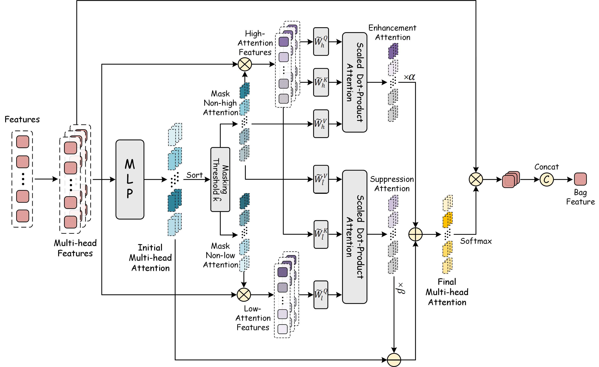

# LR-ABMIL

An end-to-end multiple instance learning (MIL) framework for whole slide image (WSI) analysis.
Instead of a two-stage pipeline with frozen patch features, LR-ABMIL trains the patch encoder and the
attention-based MIL aggregator **jointly** on the WSI patches, and supports cancer diagnosis, subtyping and
survival prediction under one training / evaluation pipeline (multi-scale input, k-fold cross validation,
EMA, AMP, DDP and W&B logging are all built in).



## Models

A model is selected with `--model=<encoder>_<mil>`, for example `--model=r18_fhabmil`.

| MIL aggregator | Description |
|----------------|-------------|
| `abmil` | Attention-based MIL with gated attention |
| `abmilx` | Multi-head attention MIL |
| `fhabmil` | Focus-High attention MIL — the main model, used by most provided configs |

| Encoder | Backbone |
|---------|----------|
| `r18` | ResNet-18 (ImageNet pre-trained) |
| `r50v2` | ResNet-50 (ImageNet pre-trained) |

## Environment

```bash
pip install torch torchvision timm torchaug einops lmdb PyTurboJPEG opencv-python pillow \
            numpy pandas scikit-learn torchmetrics GitPython lightning-utilities wandb pyyaml

pip install scikit-survival     # survival prediction tasks
pip install matplotlib h5py openslide-python shapely openTSNE umap-learn   # visualization (vision/)
```

`flash-attn` (optionally with `xformers`) can be installed to speed up the attention modules; if it is not
available the code falls back to PyTorch's scaled dot-product attention automatically.

## Data preparation

### 1. Patch LMDB

Patches are stored as **LMDB files** (one file per magnification level), which is what `--dataset_root` and
`--dataset_sub_root` point to:

| Key | Value |
|-----|-------|
| `__slide__` | pickled list of slide names |
| `__pn__` | pickled dict `{slide_name: number_of_patches}` |
| `"{slide}-{i}"` | pickled file bytes of patch `i` of that slide (`i = 0 … n-1`) |

`--dataset_root` holds the main magnification; `--dataset_sub_root` holds a second, coarser level, and the two
are combined per slide when multi-scale input is used (see `--mul_scale_input` / `--mul_scale_ratio`).

### 2. Label CSV

`--csv_path` points either to a single CSV file or to a directory containing one file per fold
(`fold_0.csv`, `fold_1.csv`, …); it defaults to `<dataset_root>/label.csv` when omitted. Two splitting modes
are supported:

| Mode | When | CSV columns |
|------|------|-------------|
| Stratified cross validation | `--cv_fold > 1` (default) and `--csv_path` is a file — the folds are generated from the CSV and `Split` is not needed | Classification: `ID,Label` or `Case,ID,Label,Split`. Survival (dataset name starting with `surv`): `Study,ID,Event,Status`, where `Label` is derived automatically by quantile-binning `Event` into 4 bins |
| Predefined split | `--cv_fold 1`, or `--csv_path` is a directory of `fold_{k}.csv` | `ID,Split,Label` (extra columns such as `Case`/`Study` are allowed), or `Case,ID,Label,Split`; a 2-column `ID,Label` CSV is split randomly using `--val_ratio` |

`Split` takes the values `train` / `val` / `test`; if a fold has no validation split, the test set is used for
validation as well (`--val2test` merges the validation split into the test set). Supported `--datasets` values:
`brca` (subtyping, `IDC`/`ILC`), `panda` (grading), `call` (diagnosis), and any name starting with `surv` for
survival prediction.

## Usage

Single GPU:

```bash
python main.py \
    --datasets=brca \
    --dataset_root=/path/to/brca_224.lmdb \
    --dataset_sub_root=/path/to/brca_224_level1.lmdb \
    --csv_path=/path/to/subtyping_tcga_brca.csv \
    --model=r18_fhabmil \
    --config=config/r18_brca_subtyping.yaml \
    --output_path=/path/to/results --title=brca_subtyping
```

Multiple GPUs (distributed training through `torchrun`):

```bash
bash train_dist.sh 2 --datasets=brca --dataset_root=... --csv_path=... \
    --model=r18_fhabmil --config=config/r18_brca_subtyping.yaml \
    --output_path=/path/to/results --title=brca_subtyping
```

Values in `--config` YAML are used as defaults and can be overridden by command-line flags. Provided configs:

| Config | Task | Model | Backbone |
|--------|------|-------|----------|
| `config/r18_brca_subtyping.yaml` | TCGA-BRCA subtyping (2 classes) | `r18_fhabmil` | ResNet-18 |
| `config/r18_brca_survival.yaml` | BRCA survival (4 bins) | `r18_abmilx` | ResNet-18 |
| `config/r18_call_diagnosis.yaml` | Diagnosis (2 classes) | `r18_fhabmil` | ResNet-18 |
| `config/r18_panda_grading.yaml` | PANDA grading (6 classes) | `r18_fhabmil` | ResNet-18 |
| `config/r50_brca_subtyping.yaml` | TCGA-BRCA subtyping | `r50v2_fhabmil` | ResNet-50 |
| `config/r50_panda_grading.yaml` | PANDA grading | `r50v2_fhabmil` | ResNet-50 |

Hyper-parameter search:

```bash
bash run_all_exps.sh            # grid search over learning rate × weight decay (edit the paths first)
python auto_lr_experiment.py    # the same sweep with JSON result tracking
```

`run_single_exp.sh`, `run_all_exps.sh` and `auto_lr_experiment.py` contain absolute paths, a conda environment
name and GPU ids from the machine they were written on — edit them before running. `run_single_exp.sh` also
edits the YAML in place to set `lr` / `weight_decay`.

### Main arguments

| Argument | Default | Description |
|----------|---------|-------------|
| `--datasets` | `panda` | dataset type (see above) |
| `--dataset_root` / `--dataset_sub_root` | – | main / second-level patch LMDB |
| `--csv_path` | – | label CSV file or directory of `fold_{k}.csv` |
| `--model` | `r18_abmilx` | `<encoder>_<mil>` (see Models) |
| `--config` | – | YAML config file (comma-separated list allowed) |
| `--n_classes` | `2` | subtyping 2, survival 4, grading 6 |
| `--input_dim` / `--inner_dim` | `1024` / `512` | encoder output dim (`r18`: 256, `r50v2`: 1024) / MIL inner dim |
| `--loss` | `ce` | `ce` \| `bce` \| `progressive` (grading) \| `nll_surv` (survival) |
| `--num_epoch` / `--max_epoch` | `200` / `130` | training epochs for the config / for early stopping |
| `--patient` | `20` | early-stopping patience |
| `--batch_size` | `1` | slides per batch |
| `--same_psize` | `0` | number of patches kept per slide (`0` = all) |
| `--p_batch_size` / `--p_batch_size_v` | `512` / `2048` | patches processed per forward chunk (train / val) |
| `--mul_scale_input`, `--mul_scale_ratio` | off, `2.` | multi-scale input from `--dataset_sub_root` |
| `--img_size` / `--img_transform` | `224` / `none` | patch size / augmentation (`none`, `weak`, `strong`, …) |
| `--opt` / `--lr` / `--weight_decay` / `--lr_sche` | `adam` / `2e-4` / `1e-5` / `cosine` | optimizer and schedule |
| `--warmup_epochs` | `0` | warmup epochs |
| `--cv_fold` / `--val_ratio` / `--val2test` | `5` / `0.` / off | cross-validation folds and validation split |
| `--amp` | off | automatic mixed precision |
| `--test_type` | `main` | evaluate the main model, the EMA model, or both (`ema`, `both`, `both_ema`) |
| `--num_bootstrap` / `--bootstrap_mode` | `1000` / `test` | bootstrap resampling for reporting mean ± std |
| `--output_path` / `--project` / `--title` | – | results are written to `<output_path>/<project>/<title>/` |
| `--seed` / `--random_seed` | `2021` / off | random seed (per-fold variation when enabled) |
| `--wandb` | off | log to Weights & Biases |

## Outputs

* Every fold trains for up to `--num_epoch` epochs with early stopping and saves its best checkpoint to
  `<output_path>/<project>/<title>/fold_<k>_model_best.pt` (plus `fold_<k>_ema_model_best.pt` when
  `--test_type` is not `main`). The checkpoint is selected on the validation metric: AUC for binary tasks,
  accuracy for multi-class tasks and C-index for survival (`--best_metric_index`, chosen automatically).
* Per-epoch logs print the training loss and the validation metrics; the test metrics of every fold are
  collected into a cross-validation summary printed at the end (mean and std).
* Classification metrics: AUC, accuracy, precision, recall, F1, Cohen's kappa and micro-accuracy;
  survival metric: C-index. With `--num_bootstrap` the test metrics are also reported with bootstrap
  mean ± std.

## Visualization

The `vision/` folder contains standalone scripts (edit the paths inside them) for qualitative analysis:

| Script | Purpose |
|--------|---------|
| `vision/vision.py` | t-SNE / UMAP embedding of patch features, coloured by tumor/normal annotations |
| `vision/vis_attention.py` | attention-score curves of a slide |
| `vision/vis_cam.py`, `vision/vis_heatmap.py` | attention / CAM heatmap rendered on the WSI |
| `vision/visualize_finish_hard.py` | drawing slides with their ROI annotations |

They expect an `.h5` file with the patch `coords` of each slide and, for the annotated views, the ASAP XML
annotation files of the dataset.

## Acknowledgements

The training / evaluation pipeline follows the timm style (AMP, EMA, cosine schedules, `torchrun`-based
distributed training) and the aggregators build on the original attention-based MIL formulation.
